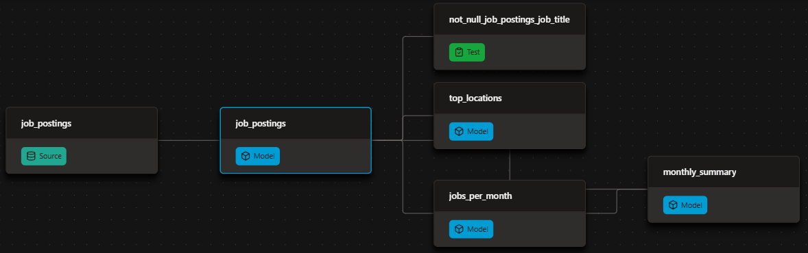

# Automated Job Postings Pipeline (v1) - dbt + DuckDB


A fully automated analytics pipeline built with dbt and DuckDB, transforming approximately 692K real-world job postings into actionable insights.

- Transform: Converts raw job postings into clean, tested, and documented analytical marts.
- Publish: Publishes the generated data warehouse and dbt documentation site.
- Automate: Uses GitHub Actions to rebuild and republish the pipeline on every push and every Monday.

## What I Built

| Component | Implementation | Where to Find It |
|---|---|---|
| **dbt Transformation Pipeline** | Raw sources → cleaned models → analytical insight marts | [`analytics/models/`](analytics/models/) |
| **Data Quality Tests** | `unique` and `not_null` tests to validate mart-level data integrity | [`schema.yml`](analytics/models/schema.yml) |
| **dbt Documentation** | Model lineage, descriptions, and column-level tests | [Live dbt Docs](https://github.com/htikehsumyat/dbt-duckdb-pipeline) |
| **Automated CI/CD** | GitHub Actions workflow to build, test, and publish the pipeline on every push | [`.github/workflows/`](.github/workflows/dbt_build.yml) |
| **Environment Management** | Separate development and production configurations using dbt targets | [`ci/profiles.yml`](ci/profiles.yml) |
| **Published DuckDB Warehouse** | Queryable analytical warehouse using DuckDB's `ATTACH` functionality | [Query the Warehouse](https://github.com/htikehsumyat/dbt-duckdb-pipeline) |

## ⚙️ The dbt Pipeline

Raw postings flow through three dbt layers — declared sources → cleaned staging views → insight marts — with tests validating each layer before the next build proceeds. The DAG below illustrates the complete workflow:



## dbt Features & Implementation

| dbt Feature | Implementation |
|---|---|
| **Declared Sources** | Defined raw data sources in [`sources.yml`](analytics/models/sources.yml) and referenced them using `source('raw', 'job_postings')` instead of hardcoding table paths in SQL. |
| **Model Dependencies** | Used `ref()` for downstream model references, allowing dbt to automatically resolve execution order and parallelize builds. |
| **Materializations** | Configured tables as the project-wide default, with staging models materialized as views. |
| **Data Tests** | Applied `unique` and `not_null` tests to mart-level grain keys in [`schema.yml`](analytics/models/sources.yml) to ensure data quality. |
| **Environment Configuration** | Separated local development and CI/production targets using [`ci/profiles.yml`](ci/profiles.yml). |

`dbt build` compiles SQL, materializes models, and fails the run if any test fails — same command locally and in CI.

## 🚀 Production

GitHub Actions runs the whole pipeline: [`.github/workflows/dbt_build.yml`](.github/workflows/dbt_build.yml)

| Trigger | What Happens |
|---|---|
| **Push to `main`** | Triggers a full pipeline rebuild. |
| **Weekly (Monday)** | Runs a scheduled rebuild to keep the pipeline up to date. |
| **Manual (`workflow_dispatch`)** | Allows the pipeline to be triggered manually from the GitHub Actions UI using the Run workflow button. |

On each workflow run, GitHub Actions automatically:

1. Installs project dependencies using `uv`.
2. Downloads the raw Parquet data.
3. Executes `dbt build` using the committed CI profile targeting prod.
4. Publishes the resulting p`rod.duckdb` database as an asset attached to a GitHub Release.

## 🦆 Query the published warehouse

[Install DuckDB](https://duckdb.org/docs/installation) (`brew install duckdb`), then from a `duckdb` session:

```sql
INSTALL httpfs;
LOAD httpfs;

ATTACH 'https://github.com/htikehsumyat/dbt-duckdb-pipeline/releases/download/warehouse/prod.duckdb' AS jobs;
USE jobs;
SHOW TABLES;

SELECT * FROM top_locations;
SELECT * FROM monthly_summary;
```
## 📖 Docs

Docs are generated with dbt docs generate and published to GitHub Pages. The site shows:

- The full lineage graph (sources → models → marts)
- Model and column descriptions from the YAML
- Which columns carry tests